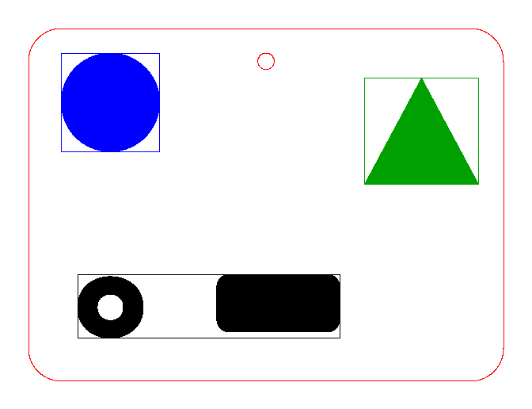

# xtool-m1-tiler

**Speed up fill engraving on the xTool M1.** Converts an SVG into an `.xcs` file for *xTool Creative Space*, splitting the engraving into compact groups so the laser head stops sweeping across empty areas.

> Made for the **xTool M1** (10 W diode laser) used with xTool Creative Space. Unofficial tool, not affiliated with xTool. Tested only on the M1, on 2 mm plywood. Always test on a scrap piece first.

*[Italiano più sotto](#italiano)*

## Why

Measured on an xTool M1 (2 mm plywood):

1. In fill engraving the head scans **every row of the whole bounding box** of a group, even where nothing is engraved. Time ≈ (height / line pitch) × (width / speed). A 200 × 198 mm plaque took **64 min** even though only a small part of the area was burnt; the amount of ink does not matter.
2. xTool Creative Space puts objects in the same group when they have the **same colour _and_ the same parameters**. Two rectangles 150 mm apart in one group: **4.3 min**. Three rectangles with different colours **and** power/speed differing by 1 point (55/100, 56/100, 55/101): **2.2 min**. A colour change alone is not enough.
3. A 1-point difference in power or speed is invisible on wood, so you can split a design into compact groups at no visible cost.

This tool does it automatically: it flattens the SVG, partitions the engraving into compact rectangles that minimise the sum of bounding boxes, gives each group its own colour and a 1-point parameter bump, and writes the `.xcs`.



Real result (130 mm dog pendant, 55 % / 150 mm/s, 0.12 mm line pitch, 4 groups): engraving estimate 12.4 → 10.6 min, whole job **15.6 min** measured including cut. Gains depend on the design: strokes spread over a large area gain most; one big compact drawing gains little (~15 %). Beyond 4-6 groups the per-group overhead (≈ 0.25-0.4 min) eats the gain. Bigger levers are speed, line pitch and size.

## Install

```bash
pip install shapely svgelements pillow numpy
git clone https://github.com/fulvioforlani/xtool-m1-tiler
cd xtool-m1-tiler
```

## Use

```bash
python -m xtool_m1_tiler examples/demo.svg -o demo.xcs --preview demo.png --size 100
python -m xtool_m1_tiler design.svg --size 130 --power 55 --speed 150 --density 83 --thickness 2
python -m xtool_m1_tiler.gui        # small Tkinter window
```

SVG conventions: **engraving = shapes with a fill** (any colour, even-odd fill rule), **cut = stroke red (`#ff0000`) with no fill**. Units/transforms/`<use>` are handled by `svgelements`. Use `--cut-color` to change the cut colour.

Options: `--allow-seams`, `--size` (long side, mm), `--thickness` (mm, sets the focus in the .xcs), `--power/--speed/--density` (engraving: density = lines per cm, 100 = 0.1 mm, 83 = 0.12 mm, 67 = 0.15 mm), `--cut-power/--cut-speed/--cut-passes`, `--max-groups`, `--overhead` (minutes lost per extra group).

## Seams between groups

When a group boundary crosses engraved strokes, a faint seam can appear on large solid areas (a darker line when the groups overlap by one line pitch, possibly a lighter one when they do not line up with the row grid). It is hardly visible on thin lines and essentially invisible to people who are not in the trade, but a trained eye sees it. The default mode (`seam_free`) therefore only cuts through empty space, which gains less on connected drawings. `--allow-seams` splits through strokes (0.12 mm overlap): faster, with a faint seam. Test on scrap and decide.

## Notes and limits

- The `.xcs` structure was derived from real files made with xTool Creative Space 1.x; it is not officially documented and may change.
- Time estimates come from an empirical model (efficiency ≈ 0.9). Measure your first piece.
- Colour/parameter bumps use power +1…+4 and speed +1…+3 (max ±4 %): visually identical on wood in tests, but check your material.
- For two-sided pieces build one file with front/back/cut on different colours and toggle layers in the software (the program moves every opened file to the top-left corner, so separate files do not stay aligned).
- Cut paths are written as fine polylines (0.05 mm sampling), not Béziers.
- Not affiliated with xTool; "xTool" and "M1" are trademarks of their owners.

## License
MIT

---

## Italiano

**Riduce il tempo dell'incisione a riempimento sull'xTool M1.** Converte un SVG in un file `.xcs` per *xTool Creative Space* dividendo l'incisione in gruppi compatti, così la testa non attraversa i vuoti.

> Pensato per **xTool M1**. Strumento non ufficiale, non affiliato a xTool. Provato solo su M1, compensato 2 mm. Prova sempre su un ritaglio.

**Perché funziona** (misure reali): nel riempimento la testa percorre ogni riga di tutto il riquadro del gruppo anche dove non incide nulla; xTool forma un gruppo per ogni combinazione di **colore + parametri**: colore diverso e potenza/velocità diverse di 1 punto (invisibili sul legno) = gruppi separati che saltano i vuoti. Esempio: due rettangoli lontani in un gruppo 4,3 min; tre gruppi 2,2 min.

**Uso**: `python -m xtool_m1_tiler disegno.svg --size 130 --power 55 --speed 150 --density 83 --thickness 2`, oppure l'interfaccia grafica `python -m xtool_m1_tiler.gui`. Nell'SVG l'**incisione** sono le forme con riempimento, il **taglio** è il tratto rosso senza riempimento. Dipendenze: `pip install shapely svgelements pillow numpy`.

Le stime di tempo sono empiriche: misura sempre il primo pezzo.
